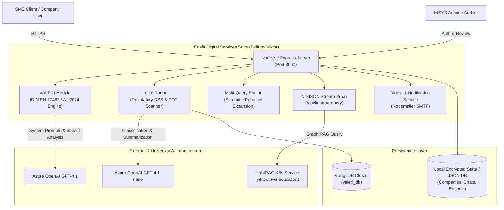

# Enefit Web Platform & Digital Services Suite (INSYS THWS)

[](https://hub.docker.com/u/viktorbuild)
[](https://www.youtube.com/watch?v=9KbtOWYTjr8)
[](https://nodejs.org/)
[](https://www.mongodb.com/)
[-0078D4?style=flat-square&logo=microsoftazure&logoColor=white)](https://azure.microsoft.com/)
[](https://www.din.de/)
[](https://www.thws.de/en/research/institutes/insys/)

<p align="center">
  <a href="https://www.youtube.com/watch?v=9KbtOWYTjr8" target="_blank">
    
  </a>
  <br>
  <strong>▶️ <a href="https://www.youtube.com/watch?v=9KbtOWYTjr8" target="_blank">Click here to watch the official portal overview & AI tools demonstration on YouTube</a></strong>
  <br>
  <em>Official walkthrough: AI tools, VALERI energy evaluation engine, Legal Radar, and enterprise services for SMEs | enefit.ai</em>
</p>

---

> [!IMPORTANT]
> **Academic Review & Data Protection Notice:**  
> This repository is an official **sanitized public copy** prepared specifically for Master's Degree Admissions and academic examination committees. Continuous development on the original production repository has been actively ongoing since **early 2024** at the Institute for Energy and Systems ([THWS INSYS](https://www.thws.de/en/research/institutes/insys/)).  
> In compliance with European Data Protection regulations (EU GDPR / DSGVO) and institutional guidelines, all operational secrets, production API keys, and actual registered SME contact records have been decoupled and replaced with environment templates (`.env.example`) and synthetic evaluation fixtures.  
> Full multi-year Git history, production deployment logs, and institutional recommendations can be discussed and verified upon request: **[kakhno.viktor@gmail.com](mailto:kakhno.viktor@gmail.com)**.

---

Full-stack production platform and suite of intelligent digital services developed for **[Enefit](https://www.enefit.ai/)** at the **Institute for Energy and Systems (INSYS)**, Technical University of Applied Sciences Würzburg-Schweinfurt ([THWS INSYS](https://www.thws.de/en/research/institutes/insys/)).

As the **Lead Developer for Digital Services**, I architected and implemented the core application layer, automated compliance systems, enterprise financial assessment engines, and AI microservices powering the platform.

---

## 🚀 Key Digital Services Architected & Built

### 1. VALERI Engine (DIN EN 17463:2021 & A1:2024 Compliance)
*Directory: `VALERI NEW/` & Core Routes in `server.js`*
- **Standard-Compliant Financial Modeling:** Engineered the full 11-step assessment workflow for energy-related investments (ERI) according to German/European standard **DIN EN 17463:2021** (VALERI standard) and amendment **A1:2024**.
- **Mathematical Simulation (`engine/math.js`):** Implemented net present value (NPV), Weighted Average Cost of Capital (WACC), dynamic annual energy price escalation rate ($epr$), general price inflation ($pr$), salvage values ($R_T$), and cash flow discounting over investment horizon $T$.
- **Automated Sensitivity & Scenario Analysis:** Generates multi-variable risk matrices and computes automated Worst-Case, Base-Case, and Best-Case boundaries.
- **Generative AI Copilot (`ai/gemini.js` / Azure OpenAI GPT-4.1):** Created structured prompting pipelines that analyze natural-language technical descriptions to automatically predict energy flow impacts, suggest WACC baseline rates, evaluate qualitative benefits, and compose executive decision proposals.
- **Steganographic Watermarking:** Integrated zero-width Unicode steganography (`applyWatermark` using `\u200B` and `\u200C`) for AI governance, verifying which report segments were synthesized by the AI assistant.

### 2. Legal Radar (Autonomous Regulatory Scanner & Digest Engine)
*Directory: `legal_radar/`*
- **Regulatory Web & RSS Crawlers:** Built background crawlers monitoring German Federal Law Gazettes (*Bundesgesetzblatt / recht.bund.de*), *gesetze-im-internet.de*, and the European Union Publications Office (OP1/OP2).
- **Automated Document Ingestion:** Downloads official legal gazettes and extracts text directly from embedded PDF documents via `pdf-parse` and `cheerio`.
- **Azure OpenAI Law Classification:** Evaluates each legal amendment using Azure OpenAI `gpt-4.1-nano`, categorizing regulations by target industry (manufacturing, renewable energy, chemicals, logistics) and generating concise impact summaries.
- **Targeted Notification Service (`mailer.js`):** Dispatches automated, personalized HTML email digests via Nodemailer/SMTP to company executives based on their subscribed industry focus areas.
- **Persistence Layer (`db.js`):** Multi-collection MongoDB database (`radar_laws`, `radar_subscribers`, `radar_settings`) with indexing and deduplication.

### 3. Multi-Query Concept & Retrieval Booster
*Directory: `multi-query-concept/`*
- **Semantic Query Expansion:** Implemented a query expansion service that analyzes ambiguous user inquiries and synthesizes 5 distinct high-precision variations tailored to energy auditing standards (e.g., *Industrie 4.0, CO2-Reduktionsstrategien, Energieaudits, Energieeinsparung*).
- **LightRAG Proxy:** Queries the distributed LightRAG Graph backend on `https://viktor.thws.education/query` with rewritten queries to ensure maximum document recall.

### 4. Förderfinder (Grant & Subsidy Discovery Navigator)
*Pages: `forderfinder-info.html`, `forderfinderEnglishScheme.png`, `forderfinderGermanScheme.png`*
- Decision tree and navigational system guiding German SMEs through federal (BAFA, KfW) and Bavarian state funding opportunities for decarbonization and energy-efficiency modernization.

### 5. News Aggregator & Custom RSS Feeds
*Pages: `news.html`, `news-info.html`*
- Microservices designed for scraping and parsing regional chamber of commerce news (IHK Würzburg-Schweinfurt).
- Containerized and published on Docker Hub:
  - [`viktorbuild/news-parser`](https://hub.docker.com/u/viktorbuild)
  - [`viktorbuild/rss-generator-ihkwurzburg`](https://hub.docker.com/u/viktorbuild)
  - [`viktorbuild/flowise-monitor`](https://hub.docker.com/u/viktorbuild)

### 6. Enterprise Onboarding & Administration Architecture
*Core: `server.js`, `dashboard.html`, `company-registration.html`, `admin-login.html`*
- Company application and registration workflow with dual review steps.
- Role-based session management (`admin` vs `company`).
- Real-time NDJSON stream proxying for AI chatbot interactions (`/api/lightrag-query`).

---

## 🏛 System Architecture



---

## 🛡 Security & Sanitization Statement

> [!NOTE]
> This public repository contains **sanitized code** prepared specifically for academic review and Master's admissions committees. All sensitive operational secrets, private API keys, SMTP credentials, and actual company registration data have been decoupled from the codebase and replaced with environment variables (`.env.example`) and synthetic demo fixtures (`data/`).

---

## 📦 Docker Container Ecosystem

Multiple services developed for this project have been containerized and deployed:

| Image Name | Purpose | Docker Hub Link |
| :--- | :--- | :--- |
| `viktorbuild/enefitbot` | Primary Enefit conversational assistant container | [Docker Hub](https://hub.docker.com/r/viktorbuild/enefitbot) |
| `viktorbuild/news-parser` | Background news crawler and content extractor | [Docker Hub](https://hub.docker.com/r/viktorbuild/news-parser) |
| `viktorbuild/rss-generator-ihkwurzburg` | RSS generator scraping regional IHK news | [Docker Hub](https://hub.docker.com/r/viktorbuild/rss-generator-ihkwurzburg) |
| `viktorbuild/flowise-monitor` | Health check & pipeline monitor for LLM chains | [Docker Hub](https://hub.docker.com/r/viktorbuild/flowise-monitor) |

---

## 🚀 Local Quickstart

### 1. Installation
```bash
git clone https://github.com/ViktorBuild/enefit_digital_services.git
cd enefit_digital_services
npm install
```

### 2. Environment Configuration
```bash
cp .env.example .env
# Edit .env with your Azure OpenAI and MongoDB credentials
```

### 3. Run Development Server
```bash
node server.js
```
The application will launch on `http://localhost:3000`.

---

## 👤 Author & Research Team
**Viktor** — Lead Developer of Digital Services (Continuous development since 2024)  
Institute for Energy and Systems ([INSYS](https://www.thws.de/en/research/institutes/insys/)), THWS  
Email: [kakhno.viktor@gmail.com](mailto:kakhno.viktor@gmail.com) • GitHub: [@ViktorBuild](https://github.com/ViktorBuild) • Docker Hub: [viktorbuild](https://hub.docker.com/u/viktorbuild)
